<div align="center">

# 🚗 AUTOVISION
### Real-Time AI Driver Drowsiness, Inattention & Safety Monitoring System

[](https://rishit-goelcod.github.io/AUTOVISION/)
[](https://www.python.org/)
[](https://developers.google.com/mediapipe)
[](https://scikit-learn.org/)
[](https://opencv.org/)
[](LICENSE)

<br/>

**AUTOVISION** is a high-speed, lightweight computer vision and machine learning system that continuously detects driver fatigue, micro-sleeps, yawning, and visual distraction (looking away or looking down at phones) in real time using a standard RGB webcam — with zero GPU requirements.

[🌐 Try In-Browser Live Demo](https://rishit-goelcod.github.io/AUTOVISION/) • [📊 View Slide Deck](results/Driver_Safety_Monitor_Viva_Presentation.pptx) • [📖 Read Viva Defense Guide](PROJECT_EXPLAINED.md)

</div>

---

## 📌 Table of Contents
- [1. Overview & Motivation](#1-overview--motivation)
- [2. System Architecture](#2-system-architecture)
- [3. Feature Engineering & Biomarkers](#3-feature-engineering--biomarkers)
- [4. Machine Learning Models](#4-machine-learning-models)
- [5. Experimental Benchmarks](#5-experimental-benchmarks)
- [6. Real-Time HUD & Temporal Filtering](#6-real-time-hud--temporal-filtering)
- [7. Interactive Web App (GitHub Pages)](#7-interactive-web-app-github-pages)
- [8. Quickstart & Installation](#8-quickstart--installation)
- [9. Repository Structure](#9-repository-structure)
- [10. Viva Defense & Academic Reference](#10-viva-defense--academic-reference)
- [11. License & Acknowledgments](#11-license--acknowledgments)

---

## 1. Overview & Motivation

Driver fatigue and visual distractions cause over **20% of fatal roadway crashes worldwide**, claiming hundreds of thousands of lives every year. Existing heavy deep learning solutions (3D CNNs, Vision Transformers) suffer from:
- ❌ High latency and computational cost requiring expensive onboard GPUs.
- ❌ "Black-box" opacity that fails to explain *why* an alert fired.
- ❌ Extreme sensitivity to camera calibration and head distance.

**AUTOVISION** solves these challenges through an elegant **hybrid pipeline**:
1. High-frequency **MediaPipe 468-point 3D Face Mesh** extraction running at 30+ FPS on edge CPUs.
2. Mathematically invariant **geometric biomarker ratios** (scale- and translation-independent).
3. Calibrated **Logistic Regression classifiers** offering full probabilistic explainability ($0.0 \to 1.0$).
4. **Temporal persistence hysteresis filtering** to eliminate false flickers from natural blinks and glances.

---

## 2. System Architecture

The end-to-end dataflow transitions from raw video frames to audio-visual driver interventions:

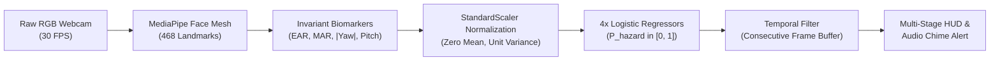

<div align="center">
  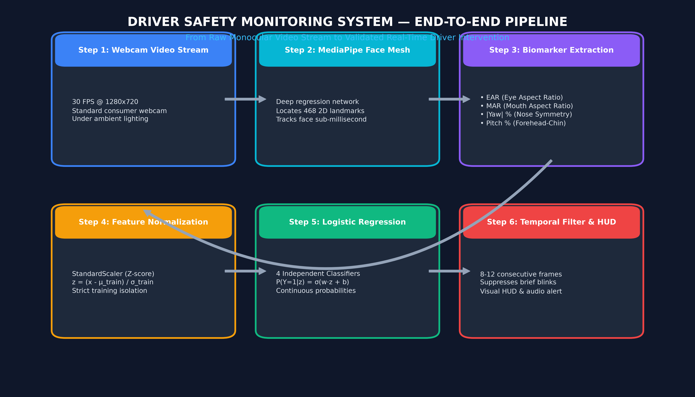
</div>

---

## 3. Feature Engineering & Biomarkers

Instead of feeding high-dimensional raw pixel arrays directly to ML classifiers, AUTOVISION extracts **4 foundational physiological indicators**:

<div align="center">
  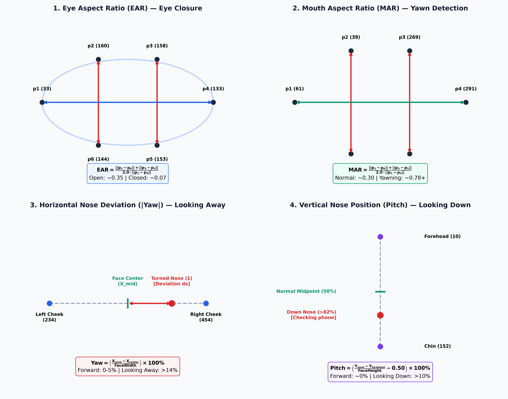
</div>

### 1. Eye Aspect Ratio (EAR) — Eye Closure & Drowsiness
Quantifies vertical eye opening normalized by horizontal width using 6 landmark coordinates per eye (Soukupová & Čech formula):
$$\text{EAR} = \frac{\|p_2 - p_6\| + \|p_3 - p_5\|}{2 \|p_1 - p_4\|}$$
- **Normal Open Eyes:** $\text{EAR} \approx 0.28 - 0.38$
- **Closed / Micro-sleep:** $\text{EAR} < 0.20$

### 2. Mouth Aspect Ratio (MAR) — Yawning Detection
Measures oral vertical separation against total mouth width:
$$\text{MAR} = \frac{\|p_{13} - p_{14}\|}{\|p_{78} - p_{308}\|}$$
- **Normal Speaking / Resting:** $\text{MAR} \approx 0.10 - 0.35$
- **Yawning Episode:** $\text{MAR} > 0.60$

### 3. Absolute Horizontal Nose Ratio ($|\text{Yaw}|$) — Looking Away
Robust 2D landmark symmetry ratio comparing distances from the nose tip (index 1) to the left cheek (234) and right cheek (454):
$$\text{Ratio} = \frac{\|p_1 - p_{234}\|}{\|p_1 - p_{454}\|}, \quad |\text{Yaw}| = \left|\log_{10}(\text{Ratio})\right|$$
- **Facing Road Ahead:** $|\text{Yaw}| \approx 0.00 - 0.12$
- **Looking Away (Left/Right Window or Mirror):** $|\text{Yaw}| > 0.25$

### 4. Vertical Nose Proportion ($\text{Pitch}$) — Looking Down (Phone Use)
Measures the vertical position of the nose tip relative to the eye midpoint and chin line:
$$\text{Pitch} = \frac{y_{\text{nose}} - y_{\text{eyes}}}{y_{\text{chin}} - y_{\text{eyes}}}$$
- **Forward Driving Posture:** $\text{Pitch} \approx 0.30 - 0.42$
- **Head Down (Texting / Phone in Lap):** $\text{Pitch} > 0.52$

---

## 4. Machine Learning Models

Each state is classified by an independent **Logistic Regression** model trained on standard-scaled features:
$$P(Y = 1 \mid x) = \sigma(w \cdot z + b) = \frac{1}{1 + e^{-(w \cdot z + b)}}$$
where $z = \frac{x - \mu}{\sigma}$ is the z-score normalized feature.

<div align="center">
  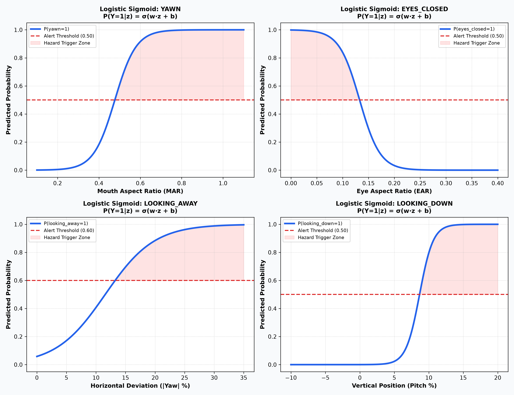
</div>

### Why Logistic Regression?
1. **Mathematical Simplicity:** Zero black-box parameters; weights directly represent feature impact.
2. **Deterministic Speed:** Inference executes in **$< 0.05$ milliseconds** per frame.
3. **Probabilistic Confidence:** Directly outputs continuous risk scores from $0.0\%$ to $100.0\%$.

<div align="center">
  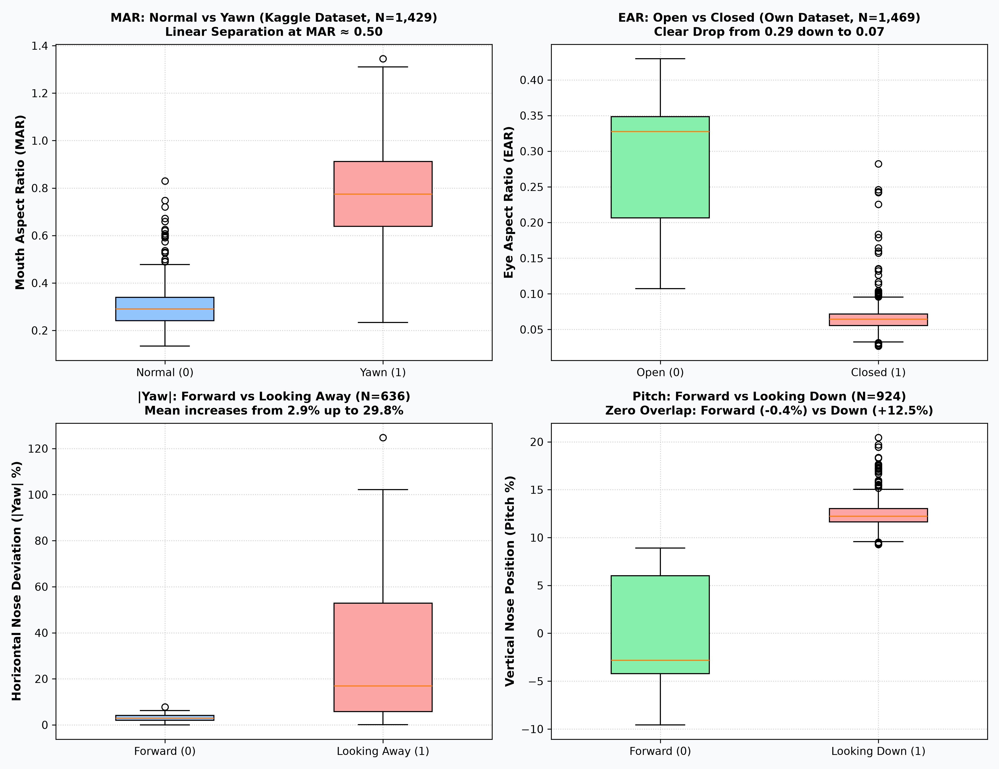
</div>

---

## 5. Experimental Benchmarks

Models were evaluated on a held-out test split of **3,534 labeled frames** (combining the Kaggle Driver Yawn & Eye Dataset and real-world webcam driving sessions):

| Model Task | Test Accuracy | Precision | Recall | F1-Score | Optimal Threshold $\tau$ |
| :--- | :---: | :---: | :---: | :---: | :---: |
| **Yawn Detection** | **98.25%** | 98.44% | 98.25% | **0.983** | $\tau = 0.50$ |
| **Eyes Closed** | **98.64%** | 98.65% | 98.64% | **0.986** | $\tau = 0.50$ |
| **Looking Away** | **88.28%** | **100.00%** | 81.25% | **0.897** | $\tau = 0.60$ |
| **Looking Down** | **99.46%** | 99.47% | 99.46% | **0.995** | $\tau = 0.50$ |

> **Zero False Alarms on Looking Away:** Tuning $\tau = 0.60$ achieved **100% precision**, completely eliminating nuisance triggers during normal rearview mirror checks.

<div align="center">
  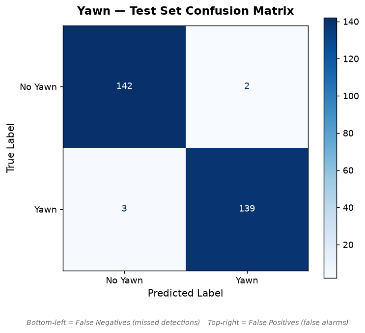
  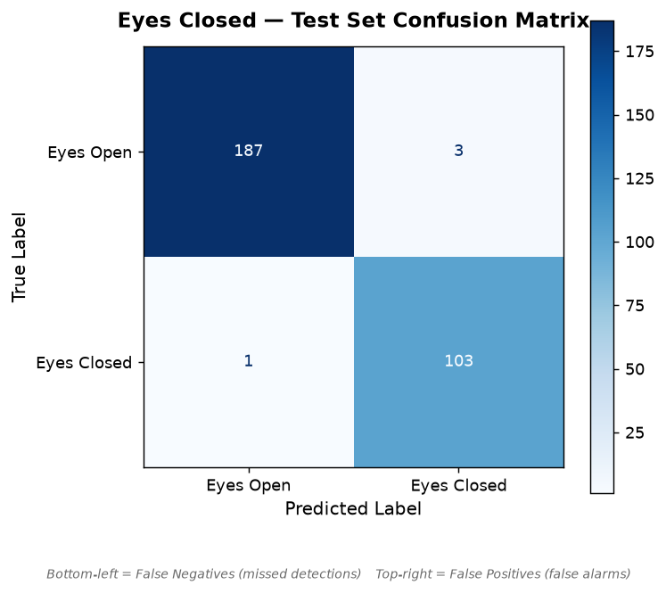
  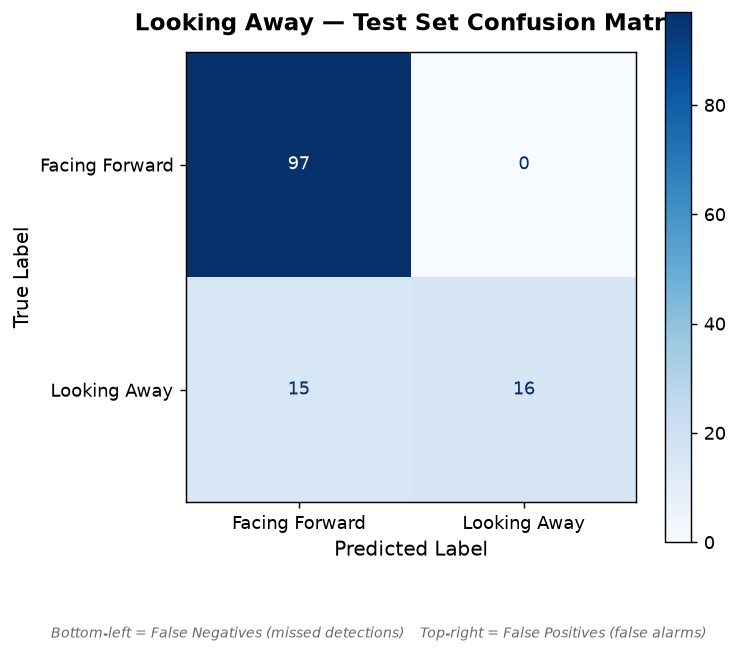
  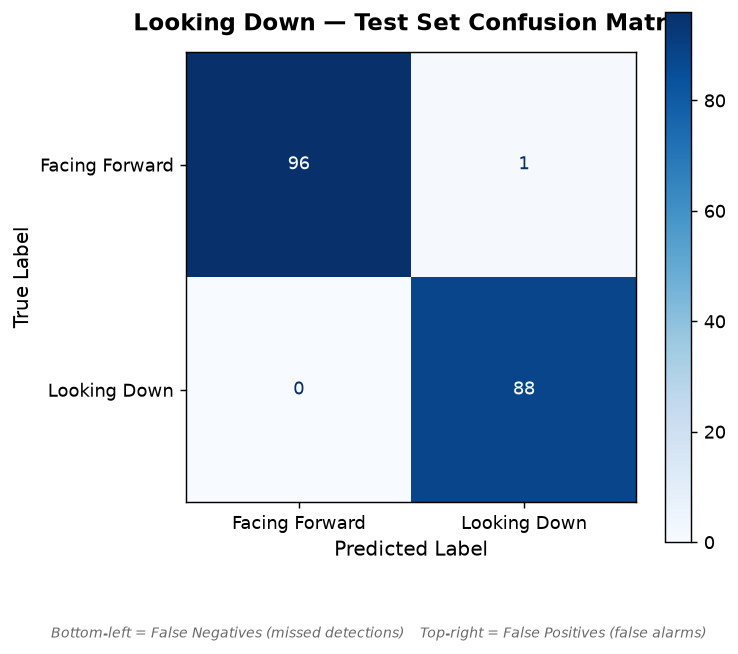
</div>

---

## 6. Real-Time HUD & Temporal Filtering

### Temporal Hysteresis Filter
To prevent rapid flickering caused by natural involuntary blinking (100–150 ms) or momentary glances, AUTOVISION implements frame persistence counters:

<div align="center">
  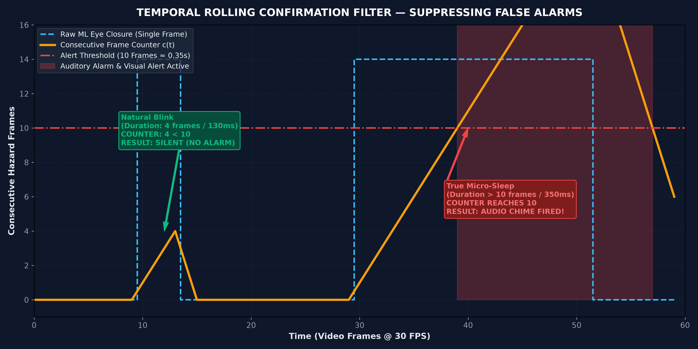
</div>

| Hazard State | Required Sustained Frames | Duration at 30 FPS |
| :--- | :---: | :---: |
| **Eyes Closed (Drowsy)** | 10 frames | ~0.33 seconds |
| **Looking Down (Phone)** | 10 frames | ~0.33 seconds |
| **Looking Away (Distraction)** | 12 frames | ~0.40 seconds |
| **Yawning (Fatigue)** | 15 frames | ~0.50 seconds |
| **No Face Detected** | 18 frames | ~0.60 seconds |

### Real-Time In-Cabin HUD
The heads-up display renders color-coded telemetry bars, live FPS, active alert banners, and a visual warning strobe when driver attention drops:

<div align="center">
  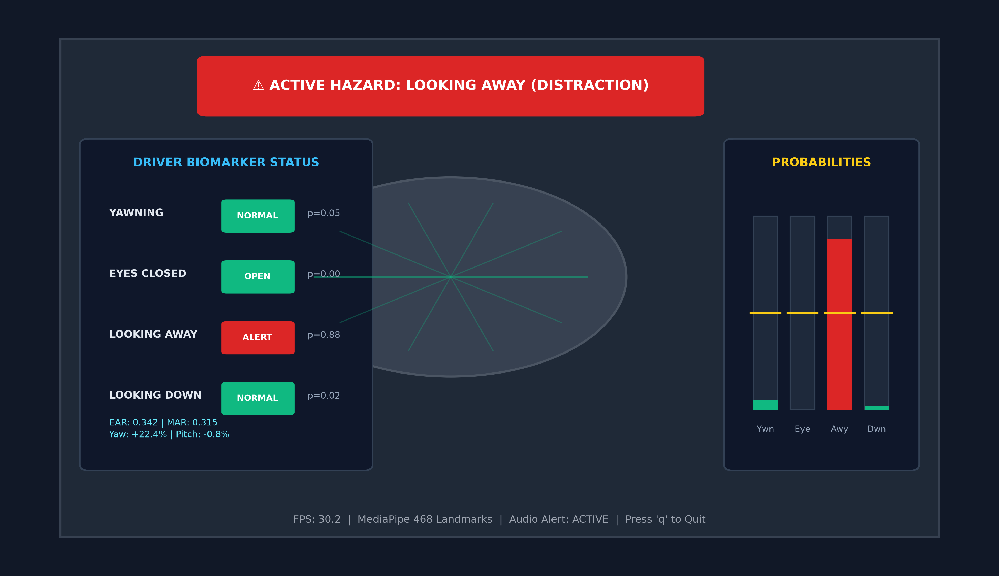
</div>

---

## 7. Interactive Web App (GitHub Pages)

Experience AUTOVISION without installing any local dependencies! We ported the MediaPipe Face Mesh and landmark geometry pipeline to a **client-side WebAssembly / JavaScript** implementation hosted on GitHub Pages:

👉 **[Launch AUTOVISION Web App](https://rishit-goelcod.github.io/AUTOVISION/)**

- ⚡ Runs 100% in your browser using WebAssembly.
- 🔒 **Total Privacy:** No video or image data is ever sent to a server.
- 📱 Works seamlessly across laptops, MacBooks, and mobile devices with a front-facing camera.

---

## 8. Quickstart & Installation

### Prerequisites
- Python 3.10 or higher
- Built-in or external USB webcam

### 1. Clone the Repository
```bash
git clone https://github.com/Rishit-GoelCOD/AUTOVISION.git
cd AUTOVISION
```

### 2. Create and Activate a Virtual Environment
```bash
# macOS / Linux
python3 -m venv .venv
source .venv/bin/activate

# Windows
python -m venv .venv
.venv\Scripts\activate
```

### 3. Install Dependencies
```bash
pip install -r requirements.txt
```

### 4. Run the Real-Time Monitor
```bash
python src/realtime_monitor.py
```
- Press **`q`** to safely quit.
- Press **`d`** to toggle raw biomarker values and probability bars.

### 5. Retrain Models (Optional)
To retrain all 4 Logistic Regression models from `data/features.csv`:
```bash
python src/train_models.py
```

---

## 9. Repository Structure

```plaintext
AUTOVISION/
├── .github/
│   └── workflows/
│       └── pages.yml           # Automated GitHub Pages CI/CD workflow
├── docs/                       # Interactive GitHub Pages Live Web Application
│   ├── index.html              # Modern dark-themed dashboard UI
│   ├── style.css               # Automotive cockpit styling & HUD animations
│   ├── app.js                  # Client-side MediaPipe Face Mesh & geometry engine
│   └── assets/                 # Architecture & biomarker diagrams
├── data/
│   └── features.csv            # 3,534 labeled biomarker rows for model training
├── models/                     # Exported scikit-learn models & scalers
│   ├── face_landmarker.task    # Google MediaPipe 468-point face landmarker
│   ├── eyes_closed_model.joblib
│   ├── eyes_closed_scaler.joblib
│   ├── yawn_model.joblib
│   ├── yawn_scaler.joblib
│   ├── looking_away_model.joblib
│   ├── looking_away_scaler.joblib
│   ├── looking_down_model.joblib
│   └── looking_down_scaler.joblib
├── notebooks/
│   └── analysis.ipynb          # Exploratory Data Analysis & visual plots
├── results/                    # Generated charts, confusion matrices & presentations
│   ├── Driver_Safety_Monitor_Viva_Presentation.pptx  # 10-slide Viva presentation
│   ├── step1_system_architecture.png
│   ├── step2_facial_landmarks_biomarkers.png
│   ├── step3_feature_distributions.png
│   ├── step4_model_sigmoid_curves.png
│   ├── step5_temporal_filter_logic.png
│   └── step6_realtime_hud_display.png
├── src/                        # Production Python source code
│   ├── features.py             # Geometric biomarker extraction (EAR, MAR, Yaw, Pitch)
│   ├── realtime_monitor.py     # Live OpenCV webcam monitor with HUD & audio chimes
│   ├── train_models.py         # Standardized scikit-learn training pipeline
│   ├── check_features.py       # Data verification & summary statistics
│   └── inspect_data.py         # Dataset inspection tool
├── PROJECT_EXPLAINED.md        # Comprehensive 12-chapter Viva defense & ML reference
├── requirements.txt            # Python dependencies
├── .gitignore                  # Git ignore rules
└── README.md                   # Repository documentation
```

---

## 10. Viva Defense & Academic Reference

Preparing for your machine learning project defense or viva voce? We have included comprehensive academic materials:

1. **[Complete Project Master Guide (PROJECT_EXPLAINED.md)](PROJECT_EXPLAINED.md):** 12 comprehensive sections covering mathematical derivations, edge cases, formula sheet, and 25 viva questions with model answers.
2. **[Viva Slide Deck (results/Driver_Safety_Monitor_Viva_Presentation.pptx)](results/Driver_Safety_Monitor_Viva_Presentation.pptx):** 10 professionally formatted widescreen slides with high-resolution diagrams ready to present to professors and evaluators.

---

## 11. License & Acknowledgments

- **Author:** Rishit Goel ([@Rishit-GoelCOD](https://github.com/Rishit-GoelCOD))
- **Guide / Supervisor:** Dr. Basab Nath
- **Institution:** Department of Artificial Intelligence & Machine Learning
- **License:** Distributed under the [MIT License](LICENSE).

<div align="center">
  <sub>Built with ❤️ using MediaPipe, scikit-learn, and OpenCV.</sub>
</div>
